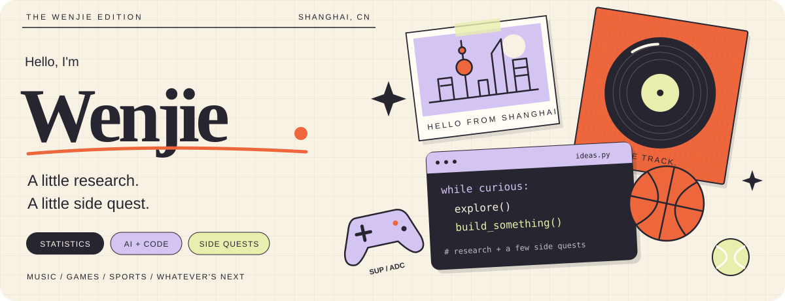

  

  <b>English</b> · <a href="README_CN.md">中文</a> · <a href="mailto:zhouwenjie_0617@163.com">Say hello ↗</a>

## Hey, I'm Wenjie 👋

**周文杰 · Shanghai · Applied Statistics @ Shanghai University of Finance and Economics**

I'm a master's student graduating in 2027. I spend time on graph learning and fraud detection, build things with AI, and get curious about a lot of things. I have ADHD; there's room here for all those interests. Also a Gemini, for anyone keeping track. ♊

*What I'm working on is easy to answer. What I'll get curious about next? Less so.*

## 🛠️ Currently tinkering with

Right now, I'm maintaining **my thesis repo** and making the research easier to follow. Along the way, I've built reusable skills for thesis writing, polishing and references.

I often end up building a tool while working on the task it was meant to help with. Academic work led to those skills; analyzing business metrics led to an automated daily report at Duxiaoman. I like asking: could this go a little more smoothly next time?

That's what I enjoy about **VibeCoding with Codex and Claude Code**. Now I'm exploring personal agents like **Pi**: could the little tools I build for myself become part of an agent that understands how I work?

## 🔎 A question I've been working on

### [What can a company's connections tell us about fraud? ↗](https://github.com/RookieZhou0617/risk-aware-financial-fraud-detection)

Financial data and annual reports already tell us a lot. My master's thesis asks what corporate relations can add once we understand a company's own signals. I combine financial data, text and company history, then explore the extra information carried by a graph.

The repo shares the method, results and uncertainty, plus a small synthetic PyTorch demo. The graph helps in some settings and hurts in others; those mixed results are part of the story.

[Explore the project](https://github.com/RookieZhou0617/risk-aware-financial-fraud-detection) · [Try the demo](https://github.com/RookieZhou0617/risk-aware-financial-fraud-detection/tree/main/examples) · [Results & limitations](https://github.com/RookieZhou0617/risk-aware-financial-fraud-detection/blob/main/docs/experiments.md)

This interest goes back to my undergraduate studies at the **University of Jinan**, where I explored telecom fraud detection with graph neural networks and ensemble learning. Class imbalance and fraud detection have followed me from one thesis to the next.

<b>A little industry context</b>

  
  &nbsp;
  
  &nbsp;
  

I've interned in risk-related roles at **Xinfei Technology, Baidu and Duxiaoman**, working across risk modeling, content safety and risk strategy. My usual toolkit includes **Python, PyTorch, scikit-learn and SQL**.

## 🎮 Away from the code

| In the mood for… | You'll find me… |
| :--- | :--- |
| **A game** | Playing **League of Legends / Honor of Kings**, usually support or ADC. I enjoy shot-calling and making decisions. Rank gains sold separately. |
| **A match** | Following **NBA, esports or tennis**. **Luka Dončić** is a favorite. |
| **A rabbit hole** | Browsing **Bilibili**, checking out a new tool, or getting interested in something else entirely. |
| **A soundtrack** | Somewhere between **陶喆 / 方大同**, **C-BLOCK / 王以太**, and the next song in my playlist. |

  

A few tracks from my playlist 🎧

- 陶喆 — 普通朋友
- 方大同 — 爱爱爱
- C-BLOCK / GAI周延 — 江湖流
- 王以太 — 不称职的天才
- 痛仰乐队 — 西湖
- John Denver — Take Me Home, Country Roads

Song recommendations are always welcome.

## 💬 Say hello

Graph learning, AI coding, a good song, or the last game you watched — happy to chat.

**Email:** [zhouwenjie_0617@163.com](mailto:zhouwenjie_0617@163.com) · **WeChat:** `zwj18602116768`

More ways to reach me

- **Phone:** +86 18602116768
- **QQ:** 2913398329

